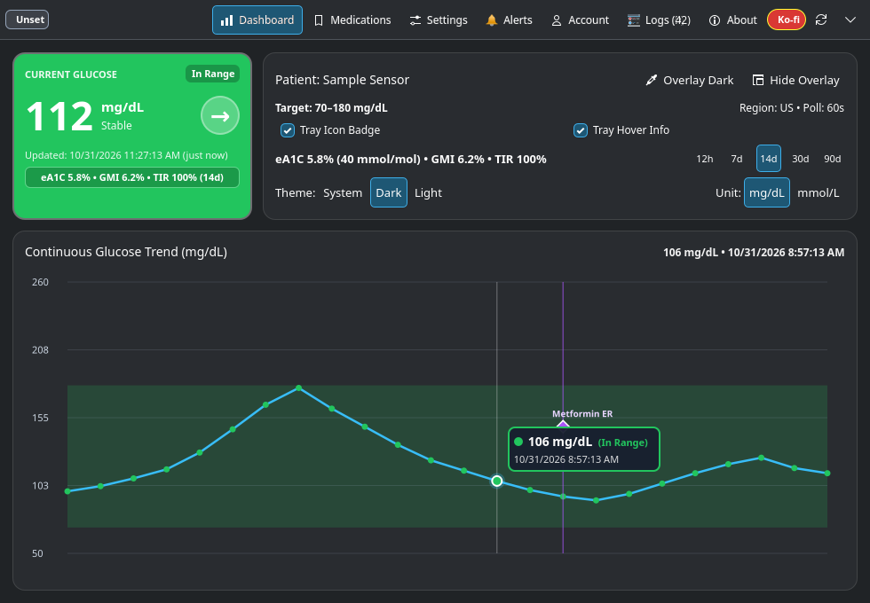
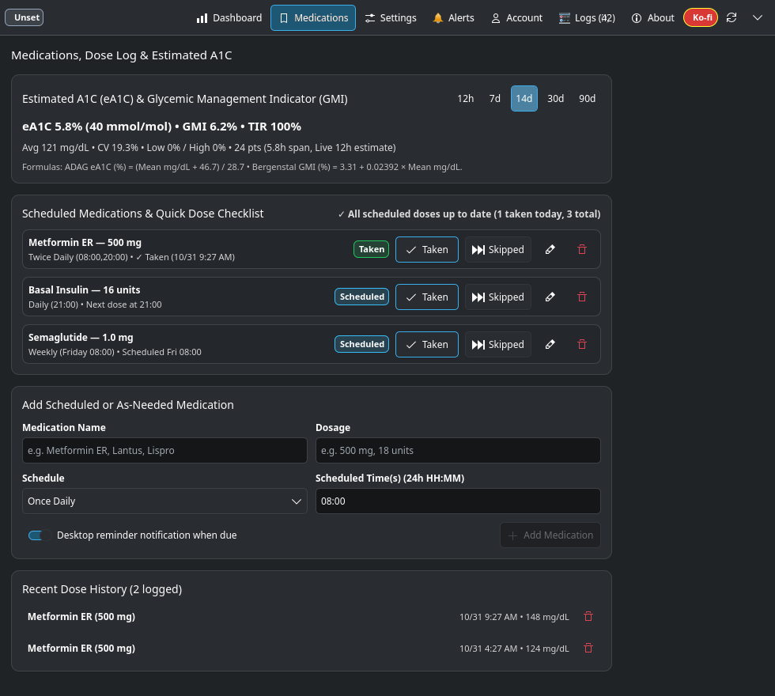
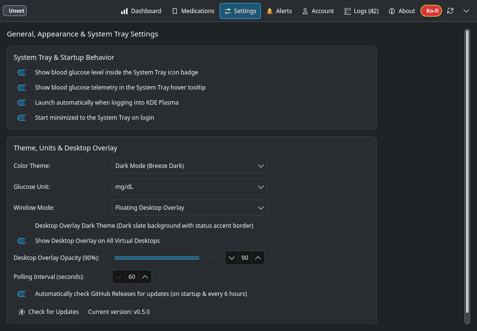
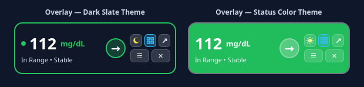
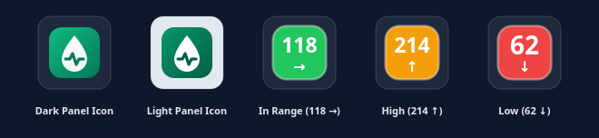

# LibreLinkUp Rust Desktop

[](https://github.com/russellmilliner/librelinkup-rust-desktop/releases/tag/v0.5.1)
[](https://github.com/russellmilliner/librelinkup-rust-desktop/releases/download/v0.5.1/LibreLinkUp-Setup-0.5.1-x64.exe)
[](https://github.com/russellmilliner/librelinkup-rust-desktop/releases/download/v0.5.1/librelinkup-rust-desktop-v0.5.1-x86_64.flatpak)
[](https://www.kernel.org/)
[](windows/README.md)
[](https://kde.org/plasma-desktop/)
[](https://www.rust-lang.org/)
[](https://www.apache.org/licenses/LICENSE-2.0)
[](https://ko-fi.com/russellmilliner)

Native **Rust** desktop applications for monitoring continuous blood glucose readings from **LibreLinkUp** on **Linux (KDE Plasma 6 / Kirigami / Qt 6)** and **Windows 10/11 (`egui` / `eframe`)**, built on a shared `librelinkup-core` crate and inspired by [LibreLinkUpDesktop](https://github.com/Crazy-Marvin/LibreLinkUpDesktop).

> **🛡️ Zero Tracking & Zero Advertisements — Forever:** LibreLinkUp Rust Desktop contains **no advertisements, no analytics, no telemetry beacons, no crash-reporting SDKs, and no third-party tracking — and never will.** The application only ever connects to your allowlisted regional LibreView API endpoint (to fetch your CGM readings) and GitHub Releases (when checking for signed application updates). All credentials, glucose history, and medication logs stay strictly on your own machine inside AES-256-GCM encrypted vaults.

---

## Release, Flatpak & Windows Links

| Item | Link / Details |
| :--- | :--- |
| **Current Version** | [**v0.5.1** (GitHub Release)](https://github.com/russellmilliner/librelinkup-rust-desktop/releases/tag/v0.5.1) • [All Releases](https://github.com/russellmilliner/librelinkup-rust-desktop/releases) |
| **Windows Installer (`x64`)** | [**`LibreLinkUp-Setup-0.5.1-x64.exe`**](https://github.com/russellmilliner/librelinkup-rust-desktop/releases/download/v0.5.1/LibreLinkUp-Setup-0.5.1-x64.exe) ([SHA-256](https://github.com/russellmilliner/librelinkup-rust-desktop/releases/download/v0.5.1/LibreLinkUp-Setup-0.5.1-x64.exe.sha256)) |
| **Windows Portable (`x64`)** | [**`LibreLinkUp-0.5.1-windows-x64-portable.zip`**](https://github.com/russellmilliner/librelinkup-rust-desktop/releases/download/v0.5.1/LibreLinkUp-0.5.1-windows-x64-portable.zip) ([SHA-256](https://github.com/russellmilliner/librelinkup-rust-desktop/releases/download/v0.5.1/LibreLinkUp-0.5.1-windows-x64-portable.zip.sha256)) |
| **Windows Documentation** | [**`windows/README.md`**](windows/README.md) — Full Windows installation, overlay controls, DPAPI security & build guide |
| **Linux Flatpak Bundle (`x86_64`)** | [**`librelinkup-rust-desktop-v0.5.1-x86_64.flatpak`**](https://github.com/russellmilliner/librelinkup-rust-desktop/releases/download/v0.5.1/librelinkup-rust-desktop-v0.5.1-x86_64.flatpak) ([SHA-256](https://github.com/russellmilliner/librelinkup-rust-desktop/releases/download/v0.5.1/librelinkup-rust-desktop-v0.5.1-x86_64.flatpak.sha256)) |
| **Flatpak Runtime** | [`org.kde.Platform//6.11`](https://flathub.org/) via [Flatpak](https://flatpak.org/) |
| **Supported Platforms** | [Linux (`x86_64`)](https://www.kernel.org/) ([KDE Plasma 6](https://kde.org/plasma-desktop/) / [Kirigami](https://develop.kde.org/frameworks/kirigami/) / [Qt 6](https://www.qt.io/)) • [**Windows 10/11 (`x64`)**](windows/README.md) ([egui](https://github.com/emilk/egui) / [eframe](https://github.com/emilk/egui/tree/master/crates/eframe)) |
| **Core Stack** | [Rust](https://www.rust-lang.org/) (`librelinkup-core`) + [KDAB CXX-Qt](https://github.com/KDAB/cxx-qt) (Linux) + [eframe/egui](https://github.com/emilk/egui) (Windows) + [Ring (AES-256-GCM)](https://github.com/briansmith/ring) |

### Quick Flatpak Install (Linux)

```bash
curl -LO https://github.com/russellmilliner/librelinkup-rust-desktop/releases/download/v0.5.1/librelinkup-rust-desktop-v0.5.1-x86_64.flatpak
flatpak install --user -y librelinkup-rust-desktop-v0.5.1-x86_64.flatpak
flatpak run io.github.russellmilliner.LibreLinkUpDesktop
```

### Quick Windows 10 / 11 Install

Download and run [**`LibreLinkUp-Setup-0.5.1-x64.exe`**](https://github.com/russellmilliner/librelinkup-rust-desktop/releases/download/v0.5.1/LibreLinkUp-Setup-0.5.1-x64.exe) (or extract the [**portable zip**](https://github.com/russellmilliner/librelinkup-rust-desktop/releases/download/v0.5.1/LibreLinkUp-0.5.1-windows-x64-portable.zip)):

```powershell
Invoke-WebRequest -Uri "https://github.com/russellmilliner/librelinkup-rust-desktop/releases/download/v0.5.1/LibreLinkUp-Setup-0.5.1-x64.exe" -OutFile "$env:TEMP\LibreLinkUp-Setup-0.5.1-x64.exe"
Start-Process -FilePath "$env:TEMP\LibreLinkUp-Setup-0.5.1-x64.exe"
```

- **Per-user install**: No administrator prompt is required. Creates a Start Menu shortcut (with Toast notification `AppUserModelID`) and an optional task to launch at Windows sign-in (`--minimized` to the system tray).
- **SmartScreen note**: The installer is not signed with a commercial EV certificate yet. If Windows SmartScreen displays *"Windows protected your PC"*, click **More info → Run anyway**.
- **Feature parity with KDE**: Live dashboard and 12-hour interactive graph, dynamic 32×32 glucose badge in the Windows notification area, floating always-on-top desktop overlay with **scroll-wheel transparency (`20%`–`100%`)** and **5 on-overlay action buttons (`🌙`/`🎨`, `⊞` On All Desktops, `↗`, `☰`, `✕`)**, stale-reading detection, urgent-low/repeat/snooze alerts with built-in alarm audio (`rodio`) and Windows Toast notifications.
- **Windows DPAPI security**: Credentials are encrypted with **AES-256-GCM** (`%APPDATA%\LibreLinkUpDesktop\credentials.enc.json`), and the 256-bit master key (`master.dpapi`) is protected by **Windows DPAPI (`CryptProtectData`)** bound to your Windows user login. Diagnostic logs are written to `%LOCALAPPDATA%\LibreLinkUpDesktop\events.log`.
- See [**`windows/README.md`**](windows/README.md) for the complete Windows user and developer guide.

---

## Screenshots

### Main Application — Live Glucose Dashboard, eA1C/GMI Pill & 12-Hour Interactive Graph (with Medication Markers)


### Medications Tab — Scheduled Checklist, Dose Logging & Estimated A1C (eA1C / GMI / TIR%)


### General, System Tray & Desktop Overlay Settings


### Floating Desktop Overlay Widget (Dark Slate & Status Color Themes)


### System Tray Icons (Default SVG Drop & Live Glucose Value Badges)


---

## Medications Tab & Glycemic Analytics (`eA1C` / `GMI` / `TIR%`)

The **Medications** tab (available in the top navigation bar on both Linux KDE Plasma 6 and Windows 10/11) combines **90-day Glycemic Analytics** with **Scheduled & As-Needed Medication Tracking** so you can track doses and see how they line up with your continuous glucose curve:

### 1. Estimated A1C (`eA1C`), `GMI` & Time in Range (`TIR%`)
- **Multi-Window Selector (`12h`, `7d`, `14d`, `30d`, `90d`)**: Switch the analysis window on either the **Dashboard** or the **Medications** tab; your selected window is saved automatically across restarts.
- **Clinical Formulas Displayed**:
  - **ADAG Estimated A1C (`eA1C`)**: `(Mean mg/dL + 46.7) / 28.7` (Nathan et al., 2008), shown in both NGSP **`%`** and IFCC **`mmol/mol`**.
  - **Glucose Management Indicator (`GMI`)**: `3.31 + 0.02392 × Mean mg/dL` (Bergenstal et al., 2018), shown in both **`%`** and **`mmol/mol`**.
  - **Time in Range (`TIR %`) & Variability**: Displays `% In Range` (between your configured Low and High thresholds), `% Below`, `% Above`, average glucose, `Min–Max`, and Coefficient of Variation (`CV %`).
- **Encrypted 90-Day Local Vault**: Samples are deduplicated into 60-second buckets and stored locally in `glucose_history.enc.json` (`AES-256-GCM`).

### 2. Adding & Editing Scheduled or As-Needed Medications
- **Supported Schedules**:
  - **`Once Daily`**: Single daily 24-hour time slot (e.g., `08:00` or `21:00`).
  - **`Twice Daily`**: Two daily 24-hour time slots separated by a comma (e.g., `08:00,20:00`).
  - **`Weekly`**: Selects a specific **Day of Week** (`Monday`–`Sunday`) plus a 24-hour time slot (e.g., `Thursday` at `08:00`).
  - **`As Needed (PRN)`**: On-demand medication or fast-acting insulin logged whenever taken without a fixed daily alarm.
- **In-Place Editing (`✏ Edit`)**: Click the **`✏`** edit button on any medication row to populate its name, dosage, schedule, weekday, time(s), and reminder setting into the form (`Update Medication` mode), then click **Save Changes** (or **Cancel**).
- **Removing a Medication (`🗑`)**: Click the **`🗑`** delete button on any medication row to remove it from your schedule.

### 3. Quick Dose Checklist, Desktop Reminders & 12-Hour Graph Markers (`💊`)
- **Live Dose Status Badges**: Each medication displays its real-time status for the current day/week:
  - **`Due Now`** (amber): Scheduled time has arrived and the dose has not been logged yet today.
  - **`✓ Taken`** (green): Dose has been logged for the current slot/day (shows timestamp).
  - **`⏭ Skipped`** (slate): Dose was explicitly marked skipped for the current slot/day.
  - **`Scheduled`** / **`As Needed`**: Upcoming scheduled time or on-demand PRN entry.
- **One-Click Dose Logging (`✓ Taken` / `⏭ Skipped` / `Log Dose`)**:
  - Clicking **`✓ Taken`** (or **`Log Dose`**) records the exact timestamp, medication name, dosage, and your **concurrent blood glucose reading (`mg/dL` or `mmol/L`)** into your encrypted `medications.enc.json` vault.
  - Clicking **`⏭ Skipped`** records that the scheduled dose was intentionally skipped so due-dose reminders stop repeating for that slot.
- **Interactive Desktop Due-Dose Notifications**:
  - When **Desktop notification when dose is due** is enabled on a medication, LibreLinkUp Rust Desktop sends a desktop notification when the scheduled time arrives, complete with interactive **`✓ Taken`** and **`⏭ Skipped`** buttons directly on the notification popup.
- **12-Hour Glucose Trend Graph Markers (`💊`)**:
  - Every dose taken within the last 12 hours is plotted directly on the **Dashboard 12-Hour Glucose Trend Graph** as a purple diamond marker (`#a855f7`) with a vertical guide line and medication label, allowing you to visually inspect post-dose glucose response.
- **Recent Dose History**:
  - Lists your recent logged and skipped doses with timestamps, dosages, and concurrent glucose readings, with a **`✕`** button to delete any entry logged by mistake.

---

## Key Features

- **Zero Tracking & Zero Advertisements — Forever**:
  - Contains **no advertisements, no user tracking, no telemetry beacons, no analytics SDKs, and no third-party data collection — and never will.**
  - Outbound network connections are strictly limited to the 12 allowlisted LibreView regional endpoints (`https://api[-<region>].libreview.io/llu`) and GitHub Releases (`russellmilliner/librelinkup-rust-desktop`) when checking for signed application updates.
- **Medications Tab & 90-Day Glycemic Analytics (`eA1C` / `GMI` / `TIR%`)**:
  - **Estimated A1C (`eA1C`), `GMI` & Time in Range (`TIR %`)**: Computes ADAG `eA1C` (`%` and IFCC `mmol/mol`), Bergenstal `GMI` (`%` and `mmol/mol`), `TIR %`, `% Below`, `% Above`, Mean Glucose, `Min–Max`, and `CV %` across `12h`, `7d`, `14d`, `30d`, and `90d` windows from your encrypted 90-day local history vault (`glucose_history.enc.json`).
  - **Scheduled & As-Needed (`PRN`) Medication Tracking**: Supports `Once Daily`, `Twice Daily`, `Weekly` (with a **Day of Week** `Monday`–`Sunday` selector), and `As Needed (PRN)` schedules, in-place medication editing (`✏`), 1-click dose logging (`✓ Taken` / `⏭ Skipped` / `Log Dose`) recording concurrent blood glucose, interactive desktop due-dose reminders, and purple `💊` diamond markers on the 12-hour glucose graph.
- **Cross-Platform Native Desktop UIs on a Shared Rust Core**:
  - **Linux (KDE Plasma 6)**: Built with `cxx-qt`, Qt 6 Quick Controls (`org.kde.desktop`), `org.kde.kirigami`, and `KColorScheme` (`KF6ColorScheme`).
  - **Windows 10 / 11 (`x64`)**: Built in pure Rust with `eframe` / `egui` (`wgpu` hardware acceleration with automatic `glow` OpenGL fallback), `tray-icon`, `rodio`, and `windows-sys`.
  - **Shared Core (`crates/librelinkup-core`)**: Unified LibreView API client (12 allowlisted regional endpoints + automatic validated regional redirect), shared session/polling state machine (`session.rs`), AES-256-GCM credential vault envelope (`crypto.rs`), settings model (`settings.rs`), staleness evaluator (`staleness.rs`), alert state machine (`alerts.rs`), and synthesized alarm generator (`audio.rs`).
- **Light, Dark & System Theme Support**:
  - Dynamically switches between Light, Dark, or your system's color scheme at runtime (`KColorSchemeManager` on KDE Plasma; `egui::Visuals` + dark/light Windows registry detection on Windows).
- **Single System Tray Icon, Primary-Screen Centering & Persistent Window Placement**:
  - Uses KDE's `StatusNotifierWatcher` on Linux and the Windows notification area (`tray-icon`) on Windows.
  - On first launch (when no saved screen position exists), the main window automatically centers on your primary monitor; thereafter, its screen, position, and size are persisted across restarts and tray restores (`window_screen_name`, `window_x`, `window_y`, `window_width`, `window_height`).
  - Adaptive header bar automatically collapses button text to icons on narrower windows and re-verifies layout geometry when restored from the system tray so the **Minimize to Tray** button never overflows the window edge.
  - Hides the main window cleanly when minimized or closed to tray so no Task Manager / Taskbar entry remains when only the floating overlay or tray icon is active.
  - Supports `--minimized` / `--autostart` / `START_MINIMIZED=1` to launch silently in the tray at sign-in (via the XDG Background portal / autostart desktop entry on Linux, and `HKCU\Software\Microsoft\Windows\CurrentVersion\Run` on Windows).
- **Ploopy High-Resolution Wheel Scrolling & Wide High-Contrast Scrollbars**:
  - **Zero-Deadzone Micro-Step Scrolling (`LibreLinkUpWheelScrollFilter`)**: Converts `REL_WHEEL_HI_RES` v120 micro-steps (`angleDelta * 0.50`) linearly with zero velocity deadzone and suppresses hover/tooltip re-evaluations during active wheel gestures so high-resolution scroll devices (Ploopy Trackball / Ploopy Knob) scroll smoothly at 60+ FPS.
  - **Wide High-Contrast Scrollbars (`HighContrastScrollBar`)**: Attaches a wide (`12px` track / `8px` thumb), high-contrast scrollbar (`minimumSize: 0.14`) across all scrollable views (**Medications**, **Logs**, **General Settings**, **Alerts**, **Account**, **About**, and **Sign In**), and preserves scroll position in the **Log Viewer** when new background log entries arrive while scrolled up.
- **Tray Glucose Badge & Hover Tooltip**:
  - **Show Glucose Level in Tray Icon**: Dynamically renders a high-contrast color-coded glucose badge directly on the system tray icon.
  - **Show Glucose Details in Tray Hover Tooltip**: Displays patient name, current reading (`mg/dL` or `mmol/L`), trend arrow, range status, and reading age when hovering the tray icon.
- **12-Hour Interactive Glucose Graph**:
  - Interactive chart with target range bands and point hover inspection (displaying exact reading, status badge, and timestamp when hovering over any graph point).
- **Floating Desktop Overlay Widget (Control Buttons, Scroll-Wheel Opacity & Persistent Placement)**:
  - Borderless always-on-top desktop utility widget showing live blood sugar, vector trend arrow, and range status without cluttering the taskbar.
  - **On-Overlay Action Buttons (2-Row Cluster)**:
    - **`🌙` / `🎨` Theme Toggle**: Switch between the Dark Slate card (`#0f172a` with status-color accent bar) and full Status Color fill directly on the overlay.
    - **`⊞` On All Desktops Toggle (`onAllDesktops`)**: Toggle whether the floating overlay is shown across all virtual desktops (highlighted in green when active) or pinned only to the current virtual desktop (also configurable via Settings, the overlay `☰` menu, and the System Tray menu).
    - **`↗` Open Main Window**: Restore and focus the main desktop window.
    - **`☰` Context Menu**: Open the quick actions menu (`Show main window`, `Refresh now`, `Switch theme`, `Show on all virtual desktops`, `Hide overlay`) even when running in overlay-only mode.
    - **`✕` Hide Overlay**: Hide the floating overlay with one click.
  - **Scroll-Wheel Transparency Control**: Adjust opacity from **`20%`** to **`100%`** in **`5%`** steps by scrolling the mouse wheel directly over the floating overlay (or via the slider in Settings).
  - **Persistent Placement & State**: Automatically saves and restores the overlay's screen coordinates, dimensions, theme, opacity, virtual-desktop visibility (`overlay_on_all_desktops`), and visibility across restarts.
- **Stale-Reading Detection & Multi-Tier Alert Engine**:
  - **Stale-Reading Detection (fails closed)**: Readings display their age (`"3 min ago"`) and turn gray (`STALE`) when older than a configurable threshold (`5`–`60` min, default `15` min), with an optional signal-loss alert. If the age cannot be determined (unparseable timestamp) *or* polling has been failing, the reading is treated as **stale** rather than fresh, so a dead sensor can never masquerade as a live value.
  - **Urgent-Low, Low, High & Stale Alerts**: Urgent-Low alerts (default `55 mg/dL`) **cannot be snoozed** and repeat every 5 minutes; Low, High, and Stale alerts follow a configurable repeat interval (`5`–`120` min) and fire immediately if the condition worsens.
  - **Alert Snooze**: Snooze non-urgent alerts for `30 min`, `1 hour`, or `2 hours` directly from interactive buttons on desktop alert notifications (`Snooze 30 min`, `Snooze 1 hr`, `Snooze 2 hr`), the Dashboard, the Alerts page, or the System Tray menu.
  - **Audible Alarm & Desktop Notifications**: Built-in synthesized two-tone alarm sound (plus custom `.wav`/`.mp3`/`.ogg` file support) paired with native desktop notifications (`org.freedesktop.Notifications` on Linux and WinRT Toast notifications on Windows) featuring interactive snooze actions.
- **AES-256-GCM Vaults for Credentials *and* Health Data**:
  - **Credentials** (`credentials.enc.json`): LibreView session token, account metadata and, only if you opt in, your password.
  - **Glucose history** (`glucose_history.enc.json`): the rolling 90-day sample series behind eA1C / GMI / Time-in-Range.
  - **Medications** (`medications.enc.json`): your medication schedule and dose log.
  - All three are **AES-256-GCM** envelopes (`ring`), written atomically at mode `0600` inside a `0700` directory (`write_file_atomic_0600`). Each vault is bound to its own AEAD label, so ciphertext cannot be swapped between them.
  - **Linux**: master secret in the desktop keyring (**Secret Service** via `secret-tool` or **KDE KWallet** via `kwallet-query`), falling back to a `0600` keyfile (`~/.config/librelinkup-kde/master.key`). Secrets are piped over **stdin**, never placed on a command line.
  - **Windows**: master secret (`master.dpapi`) protected by **DPAPI (`CryptProtectData`)** bound to your Windows user account.
  - **Fail-closed key handling**: if a vault exists but its key is unavailable, the app refuses to generate a replacement key (which would render your data permanently unreadable) and tells you what to do.
  - **Automatic migration**: plaintext `glucose_history.json` / `medications.json` from earlier versions, and legacy Electron Flatpak (`rocks.poopjournal.librelinkupdesktop`) tokens, are imported on first launch and the plaintext copies are deleted.
  - **Memory & log redaction**: secrets are `zeroize`d on drop, custom `Debug` impls print `[REDACTED]`, and e-mail addresses are masked in diagnostic logs.
- **Diagnostic Log Viewer**:
  - Built-in Log Viewer with category filtering (`AUTH`, `API`, `CRYPTO`, `TRAY`, `ALERT`, `APP`), minimum severity filtering (`DEBUG`, `INFO`, `WARN`, `ERROR`), real-time search, clipboard copy, and `.log` file export.
- **Signed, Verified Built-in Update Checker & Installer**:
  - Automatically checks GitHub Releases on startup (configurable via the **Check for updates on startup** toggle in Settings) and provides a one-click **Check for Updates** / **Install Update** workflow in the Settings page, About dialog, System Tray menu, and CLI (`--check-update` / `-u`).
  - Strict HTTPS host + repository allowlisting (`russellmilliner/librelinkup-rust-desktop`), then **two** checks before anything is executed: the companion `.sha256` (integrity) **and** a **minisign signature** verified against a public key compiled into the binary (authenticity). Unsigned or tampered artifacts are refused.
  - Linux releases now ship a signed `.flatpak` bundle, so in-app updates work there too; the Flathub build is updated by the store instead.

---

## Documentation

| Document | Contents |
| :--- | :--- |
| [`docs/ARCHITECTURE.md`](docs/ARCHITECTURE.md) | Module map, three-controller data flow, threading model, on-disk formats, alert pipeline, **invariants** |
| [`docs/SECURITY.md`](docs/SECURITY.md) | Threat model, vault crypto, trust boundaries, update-signing chain, network allowlist, known limitations |
| [`docs/RELEASING.md`](docs/RELEASING.md) | Version bump, signing keys, Flatpak metadata, publish + verify checklist |
| [`AGENTS.md`](AGENTS.md) | Coding rules for contributors and AI agents (build/test gates, hard rules, definition of done) |

### Privacy: what is stored where

| File | Contents | Protection |
| :--- | :--- | :--- |
| `credentials.enc.json` | LibreView token, account id, optional password | AES-256-GCM (label `credentials`) |
| `glucose_history.enc.json` | 90 days of glucose readings | AES-256-GCM (label `glucose-history`) |
| `medications.enc.json` | Medication schedule + dose log | AES-256-GCM (label `medications`) |
| `settings.json` | Preferences and alert thresholds | `0600`, plaintext (no identifiers) |
| `master.key` / `master.dpapi` | Vault key | `0600` file or OS keyring / DPAPI |

On Linux the files live in `~/.config/librelinkup-kde/` (`glucose_history.enc.json` in
`~/.local/share/librelinkup-kde/`); on Windows in `%APPDATA%\LibreLinkUpDesktop\`
(`%LOCALAPPDATA%` for data). Logs are kept in memory only and exports are written `0600`.

---

## Attribution & License

- **Author**: [Russell Milliner](https://github.com/russellmilliner)
- **Repository**: [https://github.com/russellmilliner/librelinkup-rust-desktop](https://github.com/russellmilliner/librelinkup-rust-desktop)
- **License**: Licensed under the [Apache License, Version 2.0](LICENSE) (see [NOTICE](NOTICE)).
- **Upstream Attribution**: This application is a native Rust rewrite (KDE Plasma 6 / Kirigami on Linux and `egui` / `eframe` on Windows) based on and inspired by [LibreLinkUpDesktop](https://github.com/Crazy-Marvin/LibreLinkUpDesktop) by [Crazy-Marvin](https://github.com/Crazy-Marvin) and contributors (licensed under the [Apache License 2.0](https://www.apache.org/licenses/LICENSE-2.0)). Tray icon vector assets in `src/qml/icons/` originate from `LibreLinkUpDesktop`.

---

## Support the Project

If you find **LibreLinkUp Rust Desktop** helpful, consider buying me a coffee on Ko-fi:

[](https://ko-fi.com/russellmilliner)

- **Ko-fi**: [https://ko-fi.com/russellmilliner](https://ko-fi.com/russellmilliner)
- **GitHub**: [https://github.com/russellmilliner/librelinkup-rust-desktop](https://github.com/russellmilliner/librelinkup-rust-desktop)

---

## Project Layout

| Path | Contents |
| :--- | :--- |
| [`crates/librelinkup-core/`](crates/librelinkup-core) | Platform-independent core shared by both apps: LibreView API client (`api.rs`), session/polling, re-auth backoff & alert decisions (`session.rs`), AES-256-GCM envelope + master-secret provider (`crypto.rs`), settings & alert policy (`models.rs`), glycemic analytics + 90-day encrypted history vault (`analytics.rs`), medication schedule/dose log with encrypted vault (`medications.rs`), signature-verifying updater (`updater.rs`), XDG paths & atomic `0600` writes (`paths.rs`), event log (`event_log.rs`), alarm WAV generator (`alert_sound.rs`) |
| `src/bridge/` | Linux CXX-Qt bridge: shared Qt-thread state (`state.rs`), state transitions (`ops.rs`), Qt object declarations (`qobject_bridge.rs`), and the three controllers `telemetry.rs` / `settings.rs` / `medications.rs`, plus XDG autostart (`autostart.rs`) |
| `src/cpp/` | Modular Qt 6 / KDE Plasma C++ helpers: façade (`app_helper.h`), QPainter tray badge renderer (`icon_renderer.h`), KWin/X11/Wayland overlay manager (`window_manager.h`), StatusNotifierItem & `org.freedesktop.Notifications` snooze action handler (`tray_manager.h`), audio playback (`audio_portal.h`), and headless QML test runner (`ui_tests.h`) |
| [`windows/`](windows/README.md) | Windows 10/11 app (`eframe` / `egui`), DPAPI integration, WinRT Toast snooze activator, SHA-256 verified self-updater, Inno Setup installer script (`windows/installer/LibreLinkUp.iss`), and build tooling (`windows/scripts/build-windows.sh`). Standalone Cargo workspace so the Linux/Flathub build never vendors Windows-only crates |

---

## Building & Testing (Linux / KDE Plasma 6)

```bash
# Core logic tests (fast, no Qt)
cargo test -p librelinkup-core

# Everything: unit, integration and the headless QML layout/behaviour suite
QT_QPA_PLATFORM=offscreen cargo test --workspace -- --test-threads=1

# Lint gate used by CI (fails on any warning)
cargo clippy --workspace --all-targets -- -D warnings

# Sign a release artifact you built locally
./scripts/sign-release.sh ~/.config/librelinkup-release/release-signing.key <artifact>

# Build release binary
cargo build --release

# Run normally or minimized to tray
./target/release/librelinkup-kde
./target/release/librelinkup-kde --minimized
```

## Building & Installing the Flatpak (Linux)

```bash
chmod +x scripts/build-flatpak.sh
./scripts/build-flatpak.sh

# Install the generated Flatpak bundle
flatpak install --user -y target/release/librelinkup-kde.flatpak
```

## Building the Windows App (`x64`)

See [**`windows/README.md`**](windows/README.md) for full details.

On **Windows** (MSVC toolchain):

```powershell
cargo test --release --manifest-path crates/librelinkup-core/Cargo.toml
cargo build --release --manifest-path windows/Cargo.toml
windows\target\release\LibreLinkUp.exe --self-test
```

**Cross-compiling from Linux** (MinGW + Wine; also builds the Inno Setup installer and portable `.zip`):

```bash
rustup target add x86_64-pc-windows-gnu      # plus mingw-w64-gcc and wine from your distro
windows/scripts/build-windows.sh --self-test  # -> windows/dist/
```

GitHub Actions ([`.github/workflows/windows.yml`](.github/workflows/windows.yml)) builds, runs `--self-test`, and packages the Windows installer and portable `.zip` on `windows-latest`, attaching them automatically to GitHub Releases on `v*` tags.

---

## Interactive Release & GitHub Sync Scripts

Interactive multi-project release and sync scripts are located in the parent workspace directory (`/home/millinr/Builds/`) and let you choose which project to work on interactively:

| Script | Purpose & Usage |
| :--- | :--- |
| **`../release-menu.sh`** | Unified interactive menu: choose which project in `~/Builds` to work on, then choose whether to bump version, sync to GitHub, deploy a release, or run tests. |
| **`../bump-version.sh`** | Select a project and interactively increment Patch, Minor, Major, or Custom version across `Cargo.toml`, `crates/librelinkup-core/Cargo.toml`, `windows/Cargo.toml`, `src/qml/AboutDialog.qml`, `README.md`, `windows/README.md`, and AppStream `metainfo.xml`. |
| **`../sync-github.sh`** | Select a project and interactively stage files (`all`, `tracked`, or `patch`), commit, optionally tag `vX.Y.Z`, and push to GitHub. |
| **`../deploy-release.sh`** | Select a project and run the end-to-end release pipeline (optional version bump → core & integration tests → Linux Flatpak bundle + Windows 10/11 Inno Setup installer & portable `.zip` (`--self-test`) + SHA-256 checksums → git tag/push → GitHub Release creation via `gh`). |
